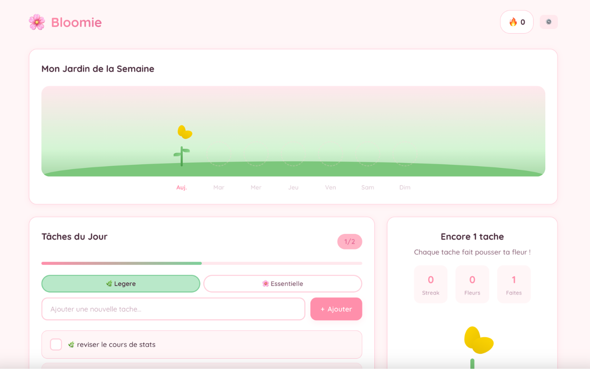
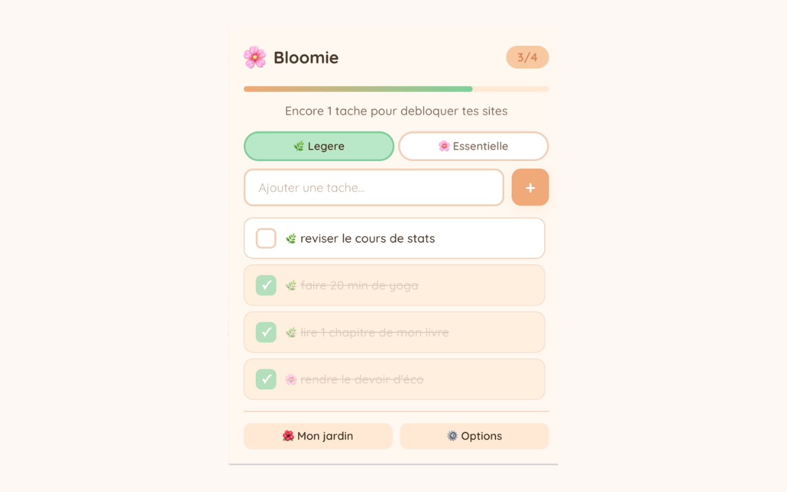
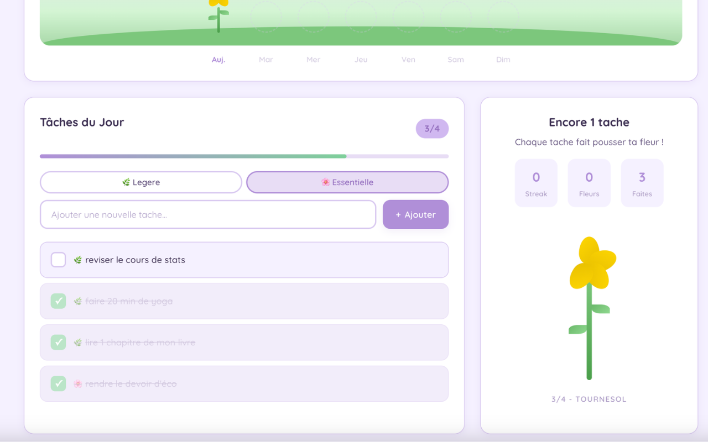
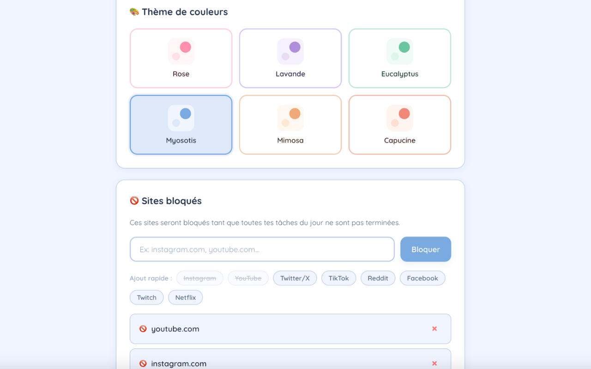

<h1 align="center">🌸 Bloomie</h1>

  <i>La to-do list qui fait fleurir vos journées… et bloque les distractions tant que le travail n'est pas fait.</i>

  

  

---

## Le principe

Vous ajoutez vos tâches du jour. Tant qu'elles ne sont pas terminées, les sites qui vous distraient (Instagram, YouTube, TikTok…) restent bloqués. Chaque tâche accomplie fait pousser une fleur, et chaque journée réussie l'ajoute à votre jardin de la semaine.

Une façon douce et motivante de rester concentré, sans culpabiliser.

---

## Fonctionnalités

<table>
  <tr>
    <td width="50%" valign="top">
      <h3>🚫 Blocage des distractions</h3>
      Choisissez les sites à bloquer, ou ajoutez-les en un clic (Instagram, YouTube, TikTok, Reddit, Netflix…). Ils se débloquent dès que toutes les tâches du jour sont faites.
    </td>
    <td width="50%" valign="top">
      <h3>🌱 Tâches légères ou essentielles</h3>
      Classez chaque tâche selon son importance et suivez votre progression avec une barre et un compteur.
    </td>
  </tr>
  <tr>
    <td width="50%" valign="top">
      <h3>🌼 Une fleur qui grandit</h3>
      Chaque tâche cochée fait pousser votre fleur du jour, jusqu'à l'éclosion complète.
    </td>
    <td width="50%" valign="top">
      <h3>🔥 Jardin et série</h3>
      Retrouvez vos fleurs de la semaine, votre série de jours réussis et le nombre total de tâches accomplies.
    </td>
  </tr>
  <tr>
    <td colspan="2" valign="top">
      <h3>🎨 Six thèmes de couleurs</h3>
      Rose, Lavande, Eucalyptus, Myosotis, Mimosa ou Capucine : Bloomie s'adapte à vos goûts.
    </td>
  </tr>
</table>

---

## Aperçu

<table>
  <tr>
    <td width="50%" align="center">
       
      La fenêtre de l'extension, accessible en un clic
    </td>
    <td width="50%" align="center">
       
      Les tâches du jour et la fleur qui grandit (thème Lavande)
    </td>
  </tr>
  <tr>
    <td colspan="2" align="center">
       
      Les options : thèmes de couleurs et sites bloqués
    </td>
  </tr>
</table>

---

## Installer Bloomie

  

---

## Technologies

---

  Conçu et développé par <a href="https://github.com/rotsy05"><b>Rotsy Radaniela</b></a>, développeuse freelance Python & IA. 
  Besoin d'une extension Chrome sur mesure ? <a href="mailto:EMAIL">Parlons-en</a>.

